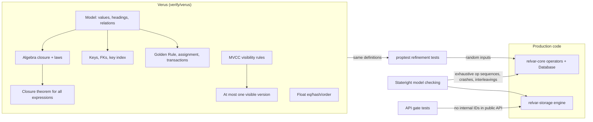

# ADR 0001: Mechanized enforcement of every TTM invariant

- Status: accepted
- Date: 2026-11-04

## Context

Relvar exists to implement the relational model of *The Third Manifesto*
(TTM) faithfully. Until now each TTM rule was enforced only by convention.
Code comments named the rule, and hand-written unit tests checked a few
cases.

An audit that read the code in November 2026 found that convention was not
enough. Real violations had shipped:

- natural join silently accepted attributes of different types;
- `SUMMARIZE` could build tuples that did not match their heading;
- `project` and `rename` silently ignored attributes the heading did not
  have;
- `rename` could merge tuples on a name collision;
- the arena `SlotRelation` kept duplicate tuples;
- `ScalarValue`'s ordering disagreed with its equality;
- rolling back or crashing after a delete lost committed data;
- constraints were not persisted when the database closed;
- a self-referencing foreign key could be broken by `UPDATE`.

Every one of these is a forbidden state that a machine could have ruled out.

## Decision

Every TTM invariant that relvar claims is enforced by at least one
mechanized check that runs in CI. Each kind of property gets the tool that
fits it best:

1. **Verus proofs** (`verify/verus/`, the `verify.yml` workflow). A model of
   the relational model is written in spec code, using vstd's finite `Set`
   and `Map` types. Every invariant is proved over that model: well-formed
   inputs yield well-formed outputs (no nulls, no duplicates, no ordering,
   correct heading) for every operator and every nested expression; the
   algebraic laws hold; constraint checks are equivalent to evaluating the
   constraint on the candidate state; transactions and statements are
   atomic. Proofs may not use `assume`, `admit`, `external_body` or axioms,
   and CI greps for them. Where the runtime logic is small and
   self-contained, it is transcribed into verified executable Verus
   functions: float equality, hashing and ordering, and the MVCC visibility
   rules.
2. **proptest refinement tests** (`relvar-core/tests/ttm_refinement.rs`).
   Every production algebra operator is compared, on random relations,
   against a small reference model written directly from the same
   definitions as the Verus spec. Each result is also checked for
   well-formedness, and the algebraic laws are checked as properties. This
   is what ties the proved model to the code that ships.
3. **Stateright model checking** (`relvar/tests/ttm_model_check.rs`).
   Short sequences of operations are explored exhaustively against the real
   `Database` on both engines: inserts, deletes, updates, begin, commit,
   rollback, crash and reopen, and interleaved transactions on the
   persistent engine. After every step the checker asserts the Golden Rule
   (`Database::verify_integrity`) and that the observed state equals the
   model's prediction.
4. **API gates** (RM Proscription 6). Tests and `compile_fail` doctests
   assert that no internal identifier is reachable through the public API
   of the `relvar` facade: no tuple id, LSN, transaction id, page id, or
   xmin/xmax.

## Why not verify the production code directly?

Verus checks only a subset of Rust. The production code relies on
`hashbrown`, `serde` derives, `Arc`, closures passed as predicates, and
`unsafe` code in the arena. Verifying it in place would mean rewriting most
of `relvar-core` in Verus's dialect and adding `vstd` as a dependency of a
`no_std` crate. Instead, the verified model is the specification, and the
refinement tests and model checker connect it to the real code. If the
"verified core" ever needs to shrink further into executable Verus code,
the right candidates are the key index, heading operations and visibility,
which are small, stable and on hot paths.

## Consequences

- A change to an operator's semantics must update the Verus model, the
  reference model and the code together, or CI goes red. That is intended.
- Proofs are pinned to one Verus release, set in `verify.yml`. Upgrading
  Verus is a deliberate change, because vstd's API moves between releases.
- Several fixes changed the public API. For example, `project` and `rename`
  now return `Result`, because projecting onto or renaming a missing
  attribute is a type error in TTM.
- See [`docs/ttm-invariants.md`](../ttm-invariants.md) for the catalog,
  which maps each prescription and proscription to its proof, how the
  runtime enforces it, and its tests.
